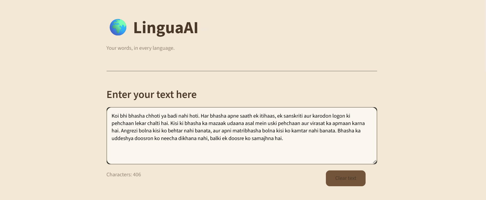
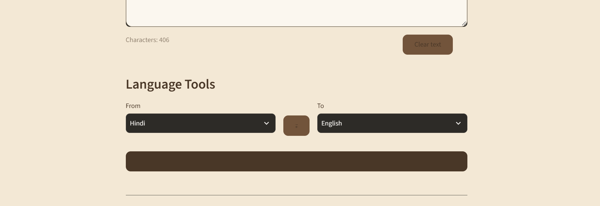
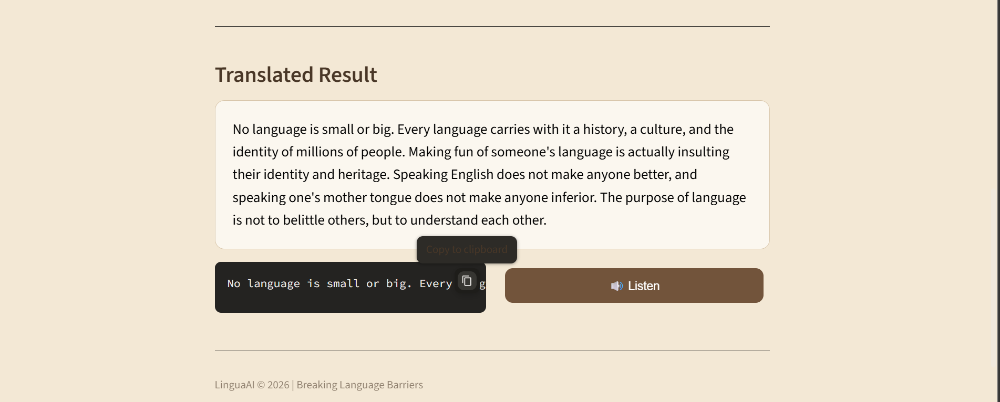

# 🌍 LinguaAI – Smart Language Translator

LinguaAI is a web-based language translation application developed using Python and Streamlit. It allows users to translate text between multiple languages through the MyMemory Translation API.

## ✨ Features

- Translate text between multiple languages.
- Select source and target languages.
- Swap source and target languages.
- Display translated text in a clean interface.
- Copy translated text.
- Listen to translated text using text-to-speech.
- Character counter and clear text functionality.

## 🛠️ Technologies Used

- Python
- Streamlit
- Requests
- MyMemory Translation API
- HTML, CSS and JavaScript

## 🌐 Supported Languages

- English
- Hindi
- French
- Spanish
- German
- Japanese
- Korean
- Chinese
- Arabic
- Italian
- Portuguese
- Russian

## 📸 Application Screenshots

### 1. Home Page


### 2. Language Selection


### 3. Translation Result



## 📁 Project Structure

```text
CodeAlpha_LanguageTranslationTool/
│
├── app.py
├── translator.py
├── requirements.txt
├── README.md
└── .gitignore
```

## ⚙️ Installation and Setup

1. Clone the repository:

```bash
git clone https://github.com/ipshita3106/CodeAlpha_LanguageTranslationTool.git
```

2. Navigate to the project directory:

```bash
cd CodeAlpha_LanguageTranslationTool
```

3. Install dependencies:

```bash
pip install -r requirements.txt
```

4. Run the application:

```bash
streamlit run app.py
```

## 🔌 Translation API

This project uses the MyMemory Translation API to process translation requests.

## 🎯 Internship Task

Developed as Task 1 – Language Translation Tool for the CodeAlpha Virtual Artificial Intelligence Internship.

## 👩‍💻 Developer

Ipshita

GitHub: https://github.com/ipshita3106